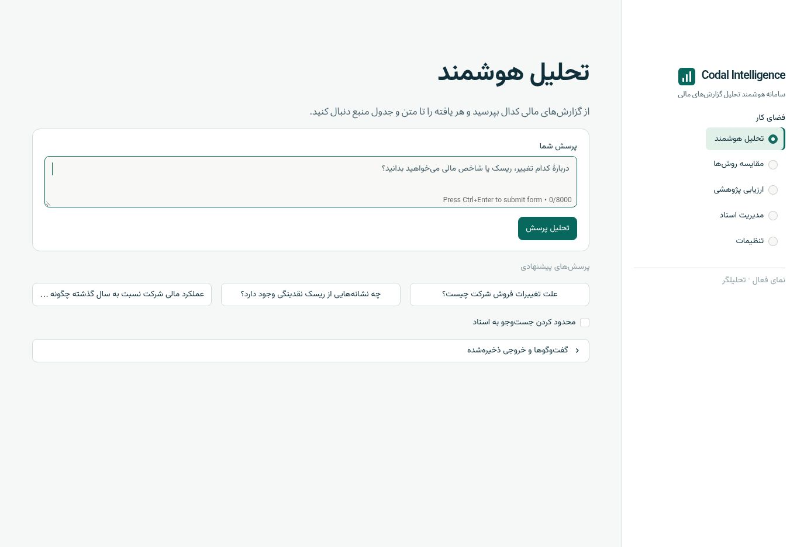
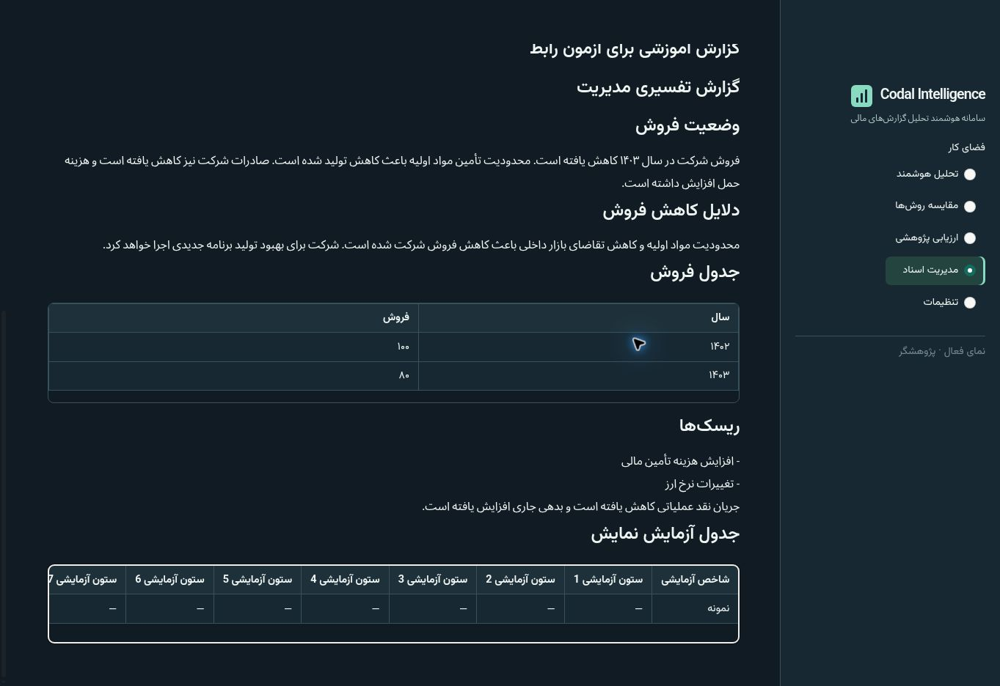

# راهنمای Codal Intelligence

دستیار گزارش‌های مالی کدال، پاسخ هر پرسش را به قطعه‌های منبع وصل می‌کند. می‌توانید یک ادعا را باز کنید، متن یا جدول مورد استناد را بخوانید و ببینید مدل آن را واقعیت صریح، استنباط ضمنی یا تفسیر نهفته دانسته است. پرسش‌های یک گفت‌وگو مستقل‌اند و تاریخچه فقط در نشست جاری نگهداری می‌شود.



## اجرای نسخه در ویندوز

در ترمینال PowerShell پای‌چارم، از ریشهٔ مخزن با محیط مجازی موجود پروژه اجرا کنید.

```powershell
git fetch origin
git switch feat/codal-intelligence-ui
git pull --ff-only origin feat/codal-intelligence-ui
.\.venv\Scripts\python.exe -m streamlit run apps/streamlit_app.py
```

نشانی محلی چاپ‌شده در ترمینال را باز کنید. برای محیط مجازی فعال با نام دیگری می‌توان از `python -m streamlit run apps/streamlit_app.py` استفاده کرد. راه‌اندازی محیط تازه و معرفی بسته‌های اختیاری در [README](../README.md) آمده است.

## صفحات و مسیر کار

| صفحه | کار قابل انجام |
| --- | --- |
| تحلیل هوشمند | طرح پرسش مستقل، انتخاب مثال، تعیین دامنه از فرادادهٔ موجود، باز کردن شاهد هر یافته، دیدن تاریخچه، کپی از ابزار کپی متن، دریافت JSON و بازخوانی استخراج ذخیره‌شده |
| مقایسه روش‌ها | اجرای روش‌های انتخابی روی یک پرسش، پاسخ‌های کنار هم یا زبانه‌ای، زمان، تعداد قطعه، توکن گزارش‌شده، وضعیت مستقل هر روش و خروجی متنی و JSON |
| ارزیابی پژوهشی | انتخاب یا بارگذاری گزارش ارزیابی، فیلتر روش و ردهٔ پرسش، بررسی امتیاز و منشأ آن، تطبیق با فایل‌های اجرا و بازبینی پاسخ مرجع و شواهد |
| مدیریت اسناد | جست‌وجوی گزارش، فیلتر شرکت و دوره، ورق‌زدن اسناد، مقایسهٔ مرز قطعه‌ها، عناوین و جدول‌ها و بررسی متن اصلی در صورت تطبیق نسخه |
| تنظیمات | انتخاب نمای تحلیلگر یا پژوهشگر و پوسته، تنظیم مدل زبانی، دمای تولید، Top-K، روش بازیابی و بودجهٔ EGAR با اعتبارسنجی تنظیمات توسط هستهٔ پروژه |

نمای **تحلیلگر** پیش‌فرض است. در **تنظیمات → پژوهشگر** زبانهٔ فرایند بازیابی، پیکربندی مؤثر، جزئیات مصرف و مسیر EGAR ظاهر می‌شود. برای دیدن رتبه‌بندی دو روش بدون فراخوانی مدل، در نمای پژوهشگر به **مقایسه روش‌ها → فقط بازیابی** بروید.

## اجرای واقعی و بازخوانی آفلاین

برای اجرای بازیابی، دو ایندکس سازگار Baseline و Proposed باید با تنظیمات مدل بردارسازی موجود ساخته شده باشند. مسیر اسناد Markdown و نام مدل در هر نصب به داده‌ها و ارائه‌دهندهٔ همان نصب بستگی دارد. **مدیریت اسناد** وضعیت فایل‌های ایندکس را نمایش می‌دهد. ساخت ایندکس با دستور `build` در CLI و با انتخاب صریح پوشهٔ ورودی انجام می‌شود.

برای تولید پاسخ، مدل و کلید ارائه‌دهندهٔ سازگار با OpenAI باید در محیط اجرای Streamlit تنظیم شده باشند. متغیرها `CODAL_LLM_MODEL` و `CODAL_LLM_API_KEY` هستند. `OPENAI_API_KEY` نیز طبق قواعد هسته پشتیبانی می‌شود. اعتبار اتصال هنگام درخواست واقعی روشن می‌شود. الگوی پیکربندی در بخش [Real model and extraction](../README.md#real-model-and-extraction) آمده است.

| نوع مشاهده یا اجرا | منشأ نتیجه |
| --- | --- |
| استخراج زنده | پاسخ سرویس پیکربندی‌شده؛ خطای سرویس یا پاسخ نامعتبر در همان روش ثبت می‌شود. در صورت نبود شواهد، خط لوله می‌تواند بدون تولید مدل پاسخ ناکافی ثبت کند. |
| بازیابی با پروفایل smoke | ایندکس واقعی FAISS، بردار هش و توکن‌ساز ساده. این اجرا اتصال مراحل را می‌آزماید و برای سنجش کیفیت معنایی کاربرد ندارد. |
| خروجی با مدل جایگزین یا دادهٔ مصنوعی | شناسنامهٔ اجرا یا استخراج این وضعیت را مشخص می‌کند. نمایش امتیازهای این پرونده‌ها صرفاً برای بازرسی است. |
| فایل ذخیره‌شده | خواندن خروجی پیشین بدون فراخوانی مدل. وقتی اطلاعات منشأ کافی نباشد، ارزیابی با برچسب منشأ نامعلوم نمایش داده می‌شود. |

برای استفادهٔ آفلاین از ایندکس نمونه، پروفایل‌های `base.yaml` و `smoke.yaml` را به همین ترتیب در تنظیمات پیشرفته انتخاب کنید. برای بازبینی یک پاسخ قبلی، فایل خروجی `extract` یا نتیجهٔ تک‌روش RAG رابط را در **تحلیل هوشمند → گفت‌وگوها و خروجی ذخیره‌شده** باز کنید.

## مقایسهٔ قابل تفسیر

| روش | ورودی و بودجه |
| --- | --- |
| مدل زبانی بدون RAG | فقط متن پرسش به مدل می‌رسد. پاسخ آزاد و محدودیت‌ها ثبت می‌شوند. فایل، شاهد، تاریخچه و نتیجهٔ روش‌های دیگر در پیام مدل حضور ندارند. |
| RAG ساده | قطعه‌های اندازه‌ثابتِ بازیابی اولیه، با دستور استخراج سه‌سطحی و بودجهٔ متن نسخهٔ ۲ |
| RAG ساختارآگاه | قطعه‌های ساختارآگاه همان مجموعه، با همان مدل، روش بازیابی، Top-K، دستور استخراج و بودجهٔ متن |
| RAG ساختارآگاه + EGAR | همان فهرست اولیهٔ ساختارآگاه با امکان بررسی کفایت و جست‌وجوی تکمیلی محدود به دامنه و بودجهٔ ثبت‌شده |

دستیار به‌طور پیش‌فرض Proposed را اجرا می‌کند و پروفایل استخراج فعال را رعایت می‌کند. صفحهٔ مقایسه برای هر سه روش RAG قرارداد نسخهٔ ۲ را به‌صراحت اعمال می‌کند تا بودجهٔ متن اولیه و دستور تولید قابل مقایسه باشند. گزینهٔ EGAR در دستیار بر شرط مستقل Proposed در مقایسه اثر نمی‌گذارد. طراحی آزمایش پایان‌نامه و برچسب‌های A تا D و D+EGAR در [راهنمای EGAR](egar.md) تعریف شده‌اند.

زمان گزارش‌شده برای هر روش دارای بازیابی، زمان همان روش به‌علاوهٔ کل زمان بازیابی اولیهٔ مشترک است. جمع زمان‌ها معادل زمان دیواری کل مقایسه نیست. مصرف واقعی توکن فقط در صورت گزارش ارائه‌دهنده نمایش داده می‌شود. کران بایتی متن برای کنترل بودجه است. هزینه‌های `estimated_cost` در فایل‌های پژوهشی از تعرفهٔ پیکربندی‌شده حاصل می‌شوند. سامانه تعرفهٔ مستقل و تأییدشده‌ای برای ارائهٔ مبلغ صورتحساب ندارد.

شناسه‌هایی مانند `E1` فقط در پاسخ همان پرسش و روش معنا دارند. اعتماد اعلام‌شدهٔ مدل کالیبره نشده است. اعتبارسنجی ساختاری، اتصال ادعا به شناسه و سند را می‌سنجد. داوری دربارهٔ درستی رقم، رابطهٔ علّی یا ریسک مالی نیازمند بررسی معنایی شواهد است. در اجرای EGAR می‌توان دورهای مکمل، کمبودها، شواهد تازه، تصمیم کفایت و علت توقف را بررسی کرد. تا وقتی شواهد کافی نباشد، محدودیت ثبت‌شدهٔ خط لوله در پاسخ دیده می‌شود.

## بررسی یک اجرا

1. گزارش خروجی `evaluate` یا `research-evaluate` را انتخاب کنید. گزارش‌های دارای «report» در نام یا ذخیره‌شده در پوشه‌های نتایج زیر `data_dir` قابل کشف‌اند. نام‌های سفارشی از طریق بارگذاری JSON در دسترس‌اند.
2. برای دیدن متن کامل شواهد، شناسنامهٔ همان اجرا را هم انتخاب کنید. در نسخهٔ ۱، فایل‌های سؤال با هش‌های گزارش تطبیق داده می‌شوند. در نسخهٔ ۲، شناسنامه تطبیق داده می‌شود و هش خروجی روش و بازیابی پرسش هنگام باز کردن جزئیات بررسی می‌شود.
3. روش، رده و معیار را انتخاب کنید. گزارش‌های نسخهٔ ۱ شباهت واژگانی، شباهت برداری، بازیابی و ارجاع را مطابق قرارداد همان گزارش نشان می‌دهند. در نسخهٔ ۲ پوشش شواهد، سنجه‌های ادعا و برچسب‌ها و اطلاعات عملیاتی بسته به داوری‌های موجود نمایش داده می‌شوند. مقدار تهی یعنی امتیاز موجود نیست. نمودار مقایسه فقط برای اجرای دارای شناسنامهٔ کامل و منشأ مدل مشخص نمایش داده می‌شود.
4. برای دیدن برچسب‌ها و مجموعه‌های شواهد مرجع پژوهشی، فایل بنچمارک همان اجرا را باز کنید. هش مجموعه باید با شناسنامهٔ اجرا یکسان باشد.

## اسناد و تنظیمات

فهرست اسناد از فرادادهٔ ایندکس یا، در غیاب آن، از فایل قطعه‌ها خوانده می‌شود. هنگام اولین دسترسی، برنامه شناسه‌ها و موقعیت بایتی رکوردها را فهرست می‌کند. تنها متن قطعهٔ انتخابی برای نمایش خوانده می‌شود. اگر متن اصلی در `data/documents` نیست، متغیر `CODAL_UI_DOCUMENT_ROOT` را به ریشهٔ Markdown مورد استفاده برای ساخت ایندکس تنظیم کنید. پیش‌نمایش متن اصلی با هش نسخهٔ قطعه‌بندی تطبیق داده می‌شود. پیوند کدال فقط از نشانی معتبر ثبت‌شده در منبع نمایش داده می‌شود.



ترتیب پیکربندی همان پیش‌فرض‌های هسته، YAMLهای انتخابی، متغیرهای محیطی و سپس تنظیمات صریح نشست است. پروفایل‌های نصب‌شده در `configs` و پروفایل تعیین‌شده توسط `CODAL_CONFIG` در بخش پیشرفته قابل انتخاب‌اند. تغییر مدل بردارسازی یا نوع بردار به ایندکس‌های بازسازی‌شده و سازگار نیاز دارد. تغییر پوسته یا نما فقط بر نمایش اثر دارد. تغییر تنظیمات تولید یا بازیابی به اجرای بعدی مربوط است. کلید و نشانی خصوصی سرویس در تنظیمات دانلودی گنجانده نمی‌شود.

## دامنهٔ پیاده‌سازی و اعتبارسنجی

- شاخهٔ پایه `feat/evidence-gap-adaptive-retrieval` در کامیت `8db5ab5`، یک کامیت جلوتر از `master` و `fix/complete-rag-migration` در `76605cc` بود. شاخهٔ رابط تاریخچهٔ این پژوهش را حفظ می‌کند.
- ورودی برنامه `apps/streamlit_app.py` است. صفحات در `apps/codal_ui/pages` و اتصال هسته، وضعیت نشست، کارهای در حال اجرا، فهرست اسناد، خواندن ارزیابی، نمایش امن و قالب‌بندی در `apps/codal_ui` قرار دارند. فونت محلی Vazirmatn نسخهٔ 33.003 با مجوز SIL OFL 1.1 همراه برنامه است. [مجوز فونت](../apps/codal_ui/assets/OFL.txt)
- در هسته، دو فایل `pipelines/extract.py` و `egar/controller.py` رویدادهای اختیاری مرحله و مصرف گزارش‌شده را در اختیار رابط می‌گذارند. رابط برای شرط بدون سند از همان کلاینت مدل استفاده می‌کند. دستورات موجود CLI و قراردادهای فایل‌های پژوهشی حفظ شده‌اند.
- `MANIFEST.in` فایل‌های رابط، فونت، مجوز و تصاویر را در توزیع سورس قرار می‌دهد. `pyproject.toml` مسیر ماژول‌های برنامه را برای AppTest معرفی می‌کند. وابستگی پایتون جدیدی اضافه نشده است.
- تست‌های یکپارچه در `test_intelligence_ui.py`، `test_streamlit.py` و `test_egar_pipeline.py` مسیر معمول صفحات، دادهٔ آزمایشی، شواهد، ارزیابی، خطای جداگانهٔ روش‌ها و ادامهٔ اجرا پس از بازاجرای رابط را پوشش می‌دهند. اجراهای مرورگر روی Chromium شامل پوستهٔ روشن و تیره، آزمون عرض ۴۵۴ پیکسل CSS، پیمایش افقی جدول ۱۷ستونه و دریافت و خواندن JSON واقعی بازیابی روی ایندکس آزمایشی بود.
- اجرای بومی ویندوز، اتصال به ارائه‌دهندهٔ واقعی، وزن‌های واقعی E5 و کیفیت پاسخ روی یک مجموعهٔ واقعی کدال در این تحویل ارزیابی نشده‌اند. تاریخچه با پایان نشست از دست می‌رود. صادرات JSON برای نگهداری نتیجه در دسترس است.

### نتیجهٔ آزمون این نسخه

| محیط یا بررسی | نتیجه |
| --- | --- |
| Python 3.12، Streamlit 1.67.0 | ۱۷۷ آزمون آفلاین موفق |
| Python 3.12، Streamlit 1.35.0 | ۱۷۷ آزمون آفلاین موفق |
| Streamlit 1.35.0 با موتور جدول تعاملی ناسازگار | ۱۷۷ آزمون موفق با نمایش جایگزین جدول |
| Ruff و compileall | موفق |
| مرورگر Chromium | ناوبری فارسی، روشن و تیره، انتخاب مثال، بازیابی و دانلود JSON و پیمایش جدول در عرض دسکتاپ و باریک بررسی شد |

دو آزمون اختیاری مدل واقعی و سرویس خارجی از مجموعهٔ آفلاین کنار گذاشته شدند. یک هشدار منسوخ‌شدن API از افزونهٔ آزمون AnyIO در هر اجرا ثبت شد.

### فایل‌های تغییر

| بخش | فایل‌ها در این تغییر |
| --- | --- |
| ورودی و نما | `apps/streamlit_app.py`، `.streamlit/config.toml`، `apps/codal_ui/theme.py`، `assets/workspace.css`، `assets/Vazirmatn.woff2` و `assets/OFL.txt` |
| مدیریت نشست و اجرای سؤال در `apps/codal_ui` | `__init__.py`، `state.py`، `jobs.py`، `analysis.py` و `configuration.py` |
| داده و نمایش در `apps/codal_ui` | `catalog.py`، `evaluations.py`، `presentation.py`، `components.py` و `safety.py` |
| پنج صفحه در `apps/codal_ui/pages` | `__init__.py`، `assistant.py`، `comparison.py`، `evaluation.py`، `documents.py` و `settings.py` |
| هسته و تست‌ها | `src/codal_rag/pipelines/extract.py`، `src/codal_rag/egar/controller.py` و سه فایل تست یکپارچهٔ نام‌برده در بالا |
| بسته‌بندی و راهنما | `MANIFEST.in`، `pyproject.toml`، `README.md`، `docs/architecture.md`، این راهنما و دو تصویر در `docs/images` |
