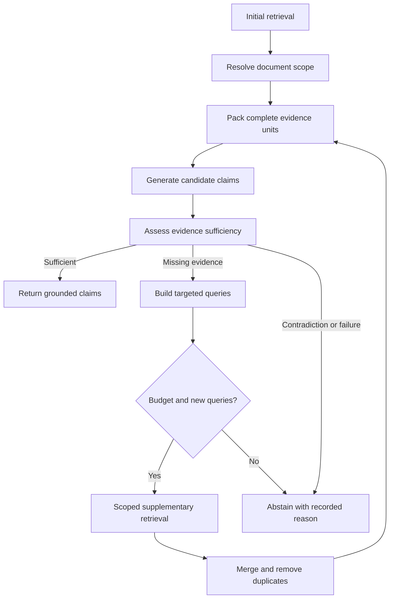

# Evidence-Gap-Guided Adaptive Retrieval (EGAR)

EGAR is an **experimental extension proposed for this project**, not an established
published method or a demonstrated improvement. It tests whether retrieving missing
complementary evidence improves grounded latent financial extraction. It is disabled
by default. The implementation is one bounded Python controller, not an agent framework.

## Relationship to the approved thesis

The thesis tests Markdown structure-aware chunking, with conceptual labels independent
of inference levels. Its main comparison remains **D versus C**.

| Arm | Chunking | Retrieval | EGAR |
| --- | --- | --- | --- |
| A | Fixed-size | Dense | Off |
| B | Structure-aware | Dense | Off |
| C | Fixed-size | Dense + BM25, RRF | Off |
| D | Structure-aware | Dense + BM25, RRF | Off |
| D+EGAR | Structure-aware | Identical initial hybrid retrieval to D | On |

Never interpret D+EGAR versus C as the isolated chunking effect. The separate D versus
D+EGAR ablation includes additional retrieval, assessment and conservative filtering;
it estimates the effect of this complete extension, not retrieval alone. A future
assessment-only arm could further separate those contributions.

The historical v1 prompt, extraction shape, dense defaults, chunk contents/IDs,
embedding representations, FAISS index format and legacy evaluation remain usable.
`experiment` deliberately opts every arm into **the same v2 generation prompt and
final context budget**. Comparing a legacy v1 D run against a v2 adaptive run would
not be a controlled ablation. New builds add exact source-unit mappings as metadata,
without adding that metadata to the embedding representation. Existing indexes work;
rebuild to obtain finer source-unit maps.

### Reference-paper mapping

The task says “three reference papers” without naming the trio. This implementation
documents its relationship to these three relevant supplied PDFs; it does not assert
that they define EGAR or that the numerical results in them transfer to Codal:

| Supplied paper | Method described by its authors | Relationship to this extension |
| --- | --- | --- |
| Dadopoulos et al., *Metadata-Driven Retrieval-Augmented Generation for Financial Question Answering*, supplied `llm2.pdf`, [arXiv:2510.24402](https://arxiv.org/abs/2510.24402) | Multi-stage metadata enrichment, contextual chunks and retrieval refinements | Motivation for retaining document/section metadata. EGAR does not reproduce their metadata-generation or reranking pipeline. |
| Shu et al., *Agentic Retrieval-Augmented Generation for Financial Document Question Answering*, supplied `llm12.pdf`, [arXiv:2605.05409](https://arxiv.org/abs/2605.05409) | Iterative retrieval/reasoning, numerical execution and adaptive routing | Motivation for bounded evidence reassessment and checked arithmetic. EGAR does not run generated Python, train their retriever or reproduce their agentic framework. |
| Samuelsen et al., *MimirRAG*, supplied `llm17.pdf`, [arXiv:2605.25030](https://arxiv.org/abs/2605.25030) | Structure/table-aware parsing, metadata, query planning, hybrid retrieval and validation in a multi-agent system | Motivation for traceability and complementary evidence. EGAR reuses this repository's chunkers and a single deterministic controller. |

The approved thesis remains the source of the chunking comparison and CodalBench plan.
Gap contracts, stopping rules, the controller and the D+EGAR arm are project additions.
RRF follows the rank-sum definition in [Cormack, Clarke and Büttcher (2009)](https://cormack.uwaterloo.ca/cormacksigir09-rrf.pdf).
No new neural reranker, GraphRAG, forecasting, trading or fine-tuning is introduced.

## Architecture and retrieval

The original pipeline is normalization → parsing → fixed/structured chunks → shared
multilingual embeddings → exact FAISS retrieval → three-level extraction → citations.

The optional path is:



BM25 uses the existing Persian character/digit normalization, with ZWNJ treated as
a word boundary, and independent lexical statistics for each chunking corpus. It
uses `log(1 + (N-df+0.5)/(df+0.5))`, default `k1=1.5`, `b=0.75`, and the same text
representation used by each method's dense embeddings. No stemmer or learned sparse
model is required. RRF sums `1/(60+rank)` over dense and BM25 candidate lists, at most
one contribution per chunk per list. Raw dense and BM25 scores are never added.
Ties use document/chunk identity. Both methods use identical retrieval parameters.
Sparse statistics are cached in memory from validated indexed records; QA does not
write source documents, embeddings or vector indexes.

Scope can contain `document_ids`, `companies`, `years`, `symbols`, and `periods`.
Lists support explicitly requested multi-company/multi-period questions in the QA
API. Missing constrained metadata fails the match. Automatic routing uses literal
known company/symbol matches and normalized Jalali year strings, or an explicitly
recorded one-document-corpus fallback. It never chooses a document by embedding
similarity. Ambiguous company/period selection causes abstention. Annual/interim
ambiguities require explicit periods or document IDs. The clustered CodalBench runner
uses one company per question; cross-company research would need a different cluster
definition and is intentionally rejected there.

The judge sees actual Persian headings in the scoped corpus. Supplementary heading
hints must come from those headings. An unmatched hint falls back to the same
document scope, never the entire unrelated corpus. Queries are normalized and
deduplicated, including against the original query.

## Sufficiency and validation

| Status | Meaning |
| --- | --- |
| `sufficient` | The question and all proposed claims pass the configured assessment and deterministic checks |
| `partially_sufficient` | Some evidence is useful, but the intended answer still has a gap |
| `insufficient` | Required evidence is absent |
| `contradictory` | Available evidence contains an unresolved conflict |
| `unverifiable` | Scope, reasoning, source anchors, calculations or service output cannot be verified |

Only `sufficient` permits a final adaptive answer. Otherwise final claim arrays are
empty, `insufficient_evidence=true`, and the trace retains candidates and the reason.
The controller does not force latent claims for explicit or implicit questions.

1. **Structural validity:** existing JSON/ID/citation validators check source identity.
2. **Anchored evidence checks:** judge excerpts must occur in cited text; every cited
   ID needs a supporting unit; scope is checked independently of the judge.
3. **Complementarity:** repeated/contained/nearly identical facts do not count twice.
   A latent claim needs distinct fact roles and a joint-support explanation; the judge
   must affirm that an individual unit is insufficient. Known source-block overlap
   is checked. Distinct chunk IDs alone are not proof of independence.
4. **Arithmetic:** Decimal checks support an anchored single-cell/table reading and ratios, percentages, percentage change,
   sums and differences with source-anchored operands, units and periods. Arithmetic
   uses two operands; `identity` validates one reading. Ambiguous table units require
   an exact `unit_quote` header and still depend on semantic row/column assessment. Rial,
   thousand/million/billion rial are converted explicitly. Persian/Arabic/ASCII
   digits, negative signs and accounting parentheses are supported. Division by zero,
   invented values, period mismatch and incorrect results fail. Absolute result
   rounding tolerance is 0.01. No generated code is executed.
5. **Semantic judgment:** a configurable LLM evaluates relevance, concepts, entailment,
   attribution, time and contradictions. Inferred causal assertions and unqualified
   distress claims have conservative deterministic rejection rules as well.

**Automated judgment is not a guarantee of factual correctness.** The persisted
status is `llm_assessed_not_verified_fact`, never “human verified.” Embedding similarity
does not establish entailment. The optional `judge: deterministic` mode identifies
verbatim statements but abstains on question-level semantic sufficiency; it is not a
hidden substitute for a semantic model. Financial rules cover explicit patterns and
simple calculations, not arbitrary accounting interpretation. Complex tables,
currency conversions, causality, negation and disclosure attribution still need review.

### Content units versus chunks

Explicit means directly stated. Implicit means a limited inference from **one coherent
paragraph or table**. Latent means combining at least two distinct complementary
units, neither alone sufficient. “Conceptual” is a separate list of labels, not a
fourth inference level.

V1 retains its historical two-ID structural requirement. V2 can cite one chunk for
a latent claim if that chunk contains two independently mapped source units; this
prevents large Baseline chunks from being penalized merely because two paragraphs
share a chunk. The analyzer checks source-unit mappings and rejects an unproven
single-chunk latent claim. One table split over two chunks still represents one unit.
New builds record exact common whitespace-token spans back to parsed Markdown blocks.
These are explicitly Markdown coordinates, not invented PDF page/row/cell locations.

## Configuration and budgets

`configs/base.yaml` keeps dense retrieval, schema v1 and EGAR off. Opt in with
`hybrid.yaml`, `research.yaml`, and/or `egar.yaml`. Configuration/environment/CLI
precedence remains unchanged. `--egar` / `--no-egar` are explicit global CLI overrides.

| Setting | Default | Effect |
| --- | ---: | --- |
| `retrieval.candidate_k` | 50 | Candidates per ranker before RRF |
| `egar.max_iterations` | 2 | Maximum supplementary rounds |
| `egar.max_queries_per_iteration` | 2 | Maximum targeted queries each round |
| `egar.supplementary_top_k` | 5 | Returned candidates per supplementary query |
| `egar.max_candidates` | 40 | Initial plus supplementary returned candidates, including duplicates |
| `extraction.max_evidence_tokens` | 4096 | Same final evidence-context budget for v2 single/adaptive arms |
| `egar.max_llm_calls` | 6 | Generation + judgment + retry attempts per question |
| `egar.timeout_seconds` | 120 | Adaptive workflow time budget after initial retrieval |
| `egar.call_timeout_seconds` | 30 | Per-operation timeout |
| `egar.max_retries` | 0 | Counted retries for non-timeout provider failures |
| `egar.minimum_sufficiency` | `sufficient` | Weaker verdicts cannot authorize final claims |

There is no universal tokenizer for configurable OpenAI-compatible providers. The
default evidence budget counts UTF-8 bytes as a conservative upper bound for ordinary
byte/subword tokenizers. It includes rendered evidence metadata, never truncates a
table or chunk, and skips whole units that do not fit. This can underuse the available
model context, especially for Persian. `pack_hits` accepts an injected token counter
for applications using a known generation tokenizer. Actual provider prompt/completion
tokens are separate nullable fields. Retrieved-token fields are explicitly labeled
upper bounds, not billing usage. Configure prices per million provider tokens to
obtain an estimated cost; absent price/usage produces `null`, not a fabricated zero.

Timeouts return without waiting for a slow worker. A daemon worker may complete its
read-only in-flight operation later; Python cannot forcibly cancel a provider request,
and its cost/usage may be unknown. Timeouts are never retried. Live SDK retries are
disabled for v2 so every attempted application call is counted. Model/index startup
and initial retrieval are outside the adaptive timeout; experiment latency includes
initial retrieval separately. Failed initial experiment retrieval leaves an incomplete
manifest and is not silently scored as a success.

## Data contracts and provenance

V1 remains readable. V2 keeps `query`, `method`, `evidence`, `extraction`,
`citation_view`, `citation_validation`, and `llm`, and adds:

- `source_trace`: source-derived metadata per evidence ID, including known original
  source locations. Claims include their own resolved trace and inference level.
- `final_retrieval`: the exact full chunks actually supplied to final extraction.
- `context_budget`: limit, counter and final use; packing exclusions are recorded in
  each adaptive assessment.
- `egar`: enabled/activated flags, reason, settings, resolved scope, original retrieval,
  missing requirements, queries, newly retrieved hits, duplicates, each candidate
  extraction/assessment, iteration count, stop reason and final decision.
- `operational`: latency, LLM calls, context/retrieved-token upper bounds, actual
  provider token usage when available, and optional configured-price cost.

Each claim analysis contains `question`, `proposed_claim`, `inference_level`,
`conceptual_labels`, `evidence_ids`, `sufficiency_status`,
`missing_evidence_requirements`, `contradiction_information`, `justification` and
`validation_status`. Numeric checks and semantic evidence units are recorded separately.
Confidence retains its old [0,1] field but means model self-assessment, not calibrated
probability. No probability or confidence is invented by the controller.

IDs such as E1 are local to a particular packed context. Each assessment stores its
own evidence-to-chunk map, so an ID cannot be interpreted across iterations without
that map. Document/chunk/source-unit IDs remain stable. The original retrieval payload
is never overwritten. The relationship is claim → evidence → chunk → Markdown
unit/section → document. Existing original PDF coordinates are copied when supplied;
none are reconstructed from Markdown.

Optional metadata now also accepts `symbol`, `financial_period`, `publication_date`,
`source_url`, and `block_locations`, e.g. `{ "12": {"page": 4, "table": 2} }` for
known original source coordinates of parser block 12. Such mappings must come from
the conversion pipeline or reviewed annotations, not guesses. Baseline chunks receive
document metadata and source-unit maps; reviewed original coordinates are copied into
mapped source units, and onto structured chunks with known block identity.

## Research evaluation

`codalbench-template` creates an **unfilled** 260-question plan, without fabricated
reports/answers. `validate-benchmark --full-protocol` checks:

- 60 reports, 20 companies, five industries, one report per company for 1401/1402/1403;
- four companies per industry, exactly one development company per industry;
- 60 answerable development questions from five companies;
- 200 test questions from 15 companies: 180 answerable plus 20 controls;
- no company leakage across splits, consistent question scope, source identities,
  and all required human-validated reference annotations.

The runner defaults to development. `--allow-test --split test` is a deliberate
release of the frozen test split, not a suggestion to tune on test. Generation receives
only question text and declared scope, never inference labels, control labels, gold
answers or annotations. Only synthetic fixtures were used for implementation.

`evidence_sets` contains alternative **complete** gold evidence sets. Coverage is 1
if any full set is covered by final evidence, not if any single gold item is found.
Exact normalized passage containment is a retrieval match, not semantic entailment.
It can undercount partial paraphrases or tokenization-damaged text; preserve exact
source excerpts in gold and review those cases. Historical fuzzy retrieval metrics
remain in the separate legacy evaluator with their original definitions.

| Metric | Definition / required inputs |
| --- | --- |
| Recall@5 / Recall@10 | Best covered fraction of an alternative gold set in the initial ranking; rank 10 is saved without expanding generation context |
| Complete Evidence Set Coverage | At least one complete reference set present in final context |
| Evidence Precision | Final chunks containing a gold passage / returned final chunks |
| Correct Document Retrieval Rate | Final chunks whose document is in the gold document union / final chunks |
| Claim Precision / Recall / F1 | One-to-one, level-matched independent adjudicated gold claims; unavailable without adjudication |
| Latent Claim Validity | Independently judged valid latent predictions / latent predictions |
| Conceptual Label F1 | Micro label counts using adjudicated claim matches, including labels of unmatched predictions/references |
| Citation validity | All cited evidence IDs structurally valid; provenance is checked separately before scoring |
| Semantic support / unsupported rate | Separately supplied human or LLM judgments, with judgment basis explicitly retained |
| Contradiction detection | Correct conflict-presence decision against a supplied judgment |
| Correct abstention rate | No final claims and explicit insufficiency on insufficient-evidence controls |
| Operational | Latency, LLM calls, initial/additional retrieval upper bounds, provider inference tokens and configured-price cost |

`final_context_recall@5/10` is separately named; it is not the same as a single-query
retrieval ranking. D and D+EGAR must have the same initial Recall@5/10 by design.
The extension can change final coverage, generation correctness and abstention.
Controller judgments are reported as `automatic_judge_support_rate` and never reused
as independent human gold. Mixed human and LLM adjudications are rejected in one report.
No missing annotation is silently replaced by a similarity score.

An adjudication JSON is keyed by question then arm, for example:

```json
{"Q001":{"D+EGAR":{"assessment_method":"human_verified","claims":[
  {"prediction_id":"latent:0","gold_claim_id":"C1","correct":true,
   "semantic_support":true,"latent_valid":true}
],"contradiction_present":false,"errors":[]}}}
```

This is a schema example only, not a real judgment. Use an empty claims list to
adjudicate an abstention. Reference annotations include validation status and can
record additional annotator/source information. The full dataset requires
`human_validated`; software fixtures are labeled `synthetic`.

Paired comparisons use identical question IDs and verify common retrieval, generation,
embedding, context, chunking and seed settings. They report the right-minus-left mean
difference and a percentile 95% confidence interval from **10,000 paired company-cluster
bootstrap resamples**, with questions in a sampled company kept together. Results
include question/company counts and separate explicit/implicit/latent analyses.
Fewer than two company clusters yields no CI. No significance or improvement is claimed
without actual evaluated data; tiny synthetic confidence intervals are not evidence.

Failure categories identify incorrect document/period, missing evidence, incomplete
multi-evidence retrieval, duplicates as complementary, numerical errors, unsupported
causality, ignored contradiction, conceptual-label errors, unsupported claims, citation
errors, unnecessary additional retrieval, and evidence not used. Each has a retrieval,
assessment or generation stage. These are researcher annotations, not infallible
automatic diagnoses.

## Windows PowerShell / PyCharm

Use the existing project's virtual environment. This extension adds **no mandatory
dependencies**. In PyCharm select that environment's Python interpreter and use the
repository root as the working directory. The same commands run in its terminal.

```powershell
git fetch origin
git switch feat/evidence-gap-adaptive-retrieval
python -m pytest -q

# Offline synthetic demo: no credentials, model download, or API request.
python -m codal_rag egar-demo --output data/egar-demo.json

# Build both real embedding indexes from your own reviewed Markdown + metadata.
python -m codal_rag --config configs/base.yaml build --input C:/reports/markdown --metadata C:/reports/metadata.json

# Original dense A/B workflow (v1).
python -m codal_rag --config configs/base.yaml batch --questions data/legacy-questions.json --output data/runs-AB
# Original hybrid C/D workflow (v1).
python -m codal_rag --config configs/base.yaml --config configs/hybrid.yaml batch --questions data/legacy-questions.json --output data/runs-CD

# Approved CodalBench planning/validation.
python -m codal_rag codalbench-template --output data/codalbench.json
# Fill from actual reports and annotations before the following commands.
python -m codal_rag validate-benchmark --dataset data/codalbench.json --full-protocol

# A-D under one common v2 contract and context budget.
python -m codal_rag --config configs/base.yaml --config configs/research.yaml experiment --dataset data/codalbench.json --arms A B C D --output data/primary
# D/D+EGAR: identical corpus, models, initial retrieval, prompt and final budget.
python -m codal_rag --config configs/base.yaml --config configs/research.yaml experiment --dataset data/codalbench.json --arms D D+EGAR --output data/ablation
python -m codal_rag research-evaluate --runs data/ablation --dataset data/codalbench.json --adjudications data/adjudications.json --resamples 10000 --output data/ablation-report.json

# A scoped interactive question. scope.json contains document_ids or company/year.
python -m codal_rag --config configs/base.yaml --config configs/hybrid.yaml --egar answer --query "آیا شرکت نمونه در 1403 نشانه فشار نقدینگی دارد؟" --scope data/scope.json --output data/answer.json

python -m streamlit run apps/streamlit_app.py
```

Set your own model/provider credentials using the existing environment configuration;
no credentials or live financial corpus are distributed. Use the same model revision,
generation provider/model, YAML profiles, source fingerprints and annotation snapshot
throughout comparisons. API model names alone do not freeze provider behavior.

The existing Streamlit page retains its comparison columns, adds a retrieval-mode
selector and one EGAR checkbox, and shows final claims, labels, citations, sufficiency
and round count. Internal candidate/judge/query traces are under the research view.

## Reproducible synthetic demonstration and limitations

`egar-demo` builds temporary real FAISS indexes, uses deterministic hash embeddings
and BM25/RRF, and injects explicitly mocked generation/judgment. It starts with the
synthetic liability-increase paragraph, finds the missing cash-flow paragraph in one
targeted round, and produces a qualified liquidity-pressure inference from both.
The JSON contains both D and D+EGAR with all source traces. It makes four mocked LLM
calls (two generations, two assessments). It is not an actual financial finding.

Representative output fields (abbreviated, illustrative):

```json
{"schema_version":2,"egar":{"enabled":true,"activated":true,
  "iteration_count":1,"supplementary_queries":["جریان نقد عملیاتی شرکت نمونه در سال 1403"],
  "stop_reason":"sufficient"},
 "extraction":{"latent":[{"claim":"ترکیب این دو نشانه ممکن است بیانگر فشار نقدینگی باشد.",
   "inference_level":"latent","conceptual_labels":["ریسک نقدینگی"],
   "evidence_ids":["E1","E2"],"evidence_sufficiency_status":"sufficient",
   "validation_status":"llm_assessed_not_verified_fact"}],"insufficient_evidence":false}}
```

Software tests exercise explicit/implicit/latent cases, missing evidence found/not
found, duplicate facts and table parts, within-chunk source units, wrong company/year,
contradictions, unsupported causality/distress, units/signs/arithmetic, provider/retrieval
failures, malformed JSON, timeout/call/iteration limits, disabled compatibility,
provenance, A-D/ablation fairness, evaluation and the Streamlit path.

Real Persian Codal reports, the planned human-validated 260 questions, model weights,
live provider judgments, native Windows execution, calibrated semantic accuracy and
full-corpus runtime/cost are **not verified by these software tests**. Human adjudication
is required to assess factual quality. No scientific improvement or significance is
claimed. See [implementation audit](egar-audit.md) and [delivery status](egar-delivery.md).
